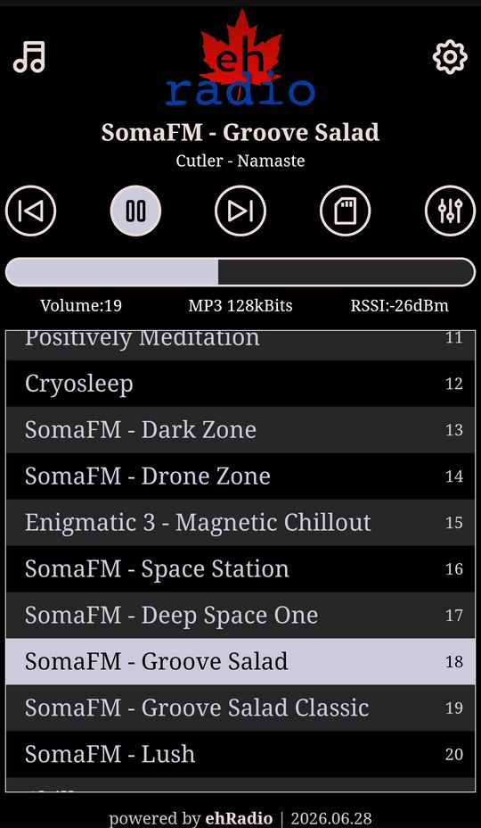
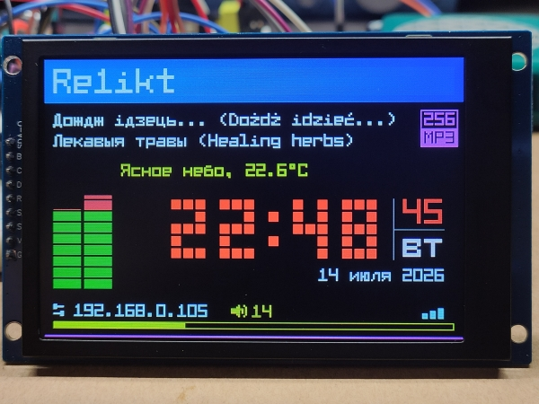

# ESP32-Radio

***This documentation is the same on the [Github Page](https://death-kiss78.github.io/ESP32-Radio/), which may be easier to read.***

## Introduction

ESP32-Radio runs on an ESP32-S3 to play Internet radio streams.

A radio may be built using an ESP32-S3, an audio decoder, a display, and some inputs.
ESP32-WROOM boards are possible but are untested. PSRAM is required so WROVER boards are not supported.
In some cases, like for the ES3C28P, no peripherals are even needed.

To develop, I prefer [VS Code](https://code.visualstudio.com/) but you may try other IDEs.
I compile using [Platformio](https://platformio.org/) but it may compile in Arduino IDE as well.
Some libraries may only be available from [Platformio Registry](https://registry.platformio.org/).

If you have zero desire to use VS Code but still want to build a radio, that's OK, too.
I would suggest you read the documentation a bit to make sure you get the right firmware for your radio.

ESP32-Radio was forked from [ёRadio](https://github.com/e2002/yoradio/) / yoRadio v0.9.533 and would not exist without
the years of work e2002 put into it.

### Upgrade note

This rebrand intentionally has no compatibility alias. Settings in the former `"ehradio"` and `"ehradioir"` NVS
namespaces are not imported. The default access-point name and mDNS prefix are now `ESP32-Radio` and `esp32radio-`;
the Home Assistant integration domain and default MQTT topic are `esp32radio` and `esp32radio/myradio/`. Move
SD-card data from `/ehradio.data` to `/esp32radio.data` if you want to keep it, and reconfigure integrations as needed.
Use the Web flasher for the initial upgrade from older firmware; its automatic version feed now uses the new project marker.

---

## Features

ESP32-Radio is focused on increasing usability for a non-builder / non-coder while at the same time
stressing future-compatibility for builders (starting with the ESP32-S3 and future ESP boards).

ESP32-Radio inherits a lot from ёRadio, but improvements have been made to make it more usable, more stable, and more customizable.

### Features For Users

- Uses ёRadio input control architecture
  - up to 2 rotaries and 6 buttons
  - touchscreen control (basic swipes and taps)
  - IR remote control
  - Nextion support removed

- 37 Display languages
  - uses a single Unicode font
  - easily changeable in WebUI

- Mobile-first WebUI design
  - many settings changeable (including themes, screen layout)
  - 50 Languages available (easily changeable in WebUI)
  - WebUI easily accessed using [ehDP](https://github.com/trip5/eh-Device-Scanner)
  - playlists can be edited, imported, exported to files
  - playlists can be imported, merged, and shared via [webstations](https://github.com/trip5/webstations) curated lists
  - radio station streams can be directly added to using [Radio-browser](https://www.radio-browser.info/) API search
  - upload files directly using the SD Card Manager

- [Web flasher](https://death-kiss78.github.io/ESP32-Radio/firmware.html) & Internet OTA updates
  - make getting a new version easy-peasy
  - *caveat:* your build must be in the `builds` folder of this repository

- MQTT, Telnet, HTTP
  - almost all WebUI [commands](Commands.md) are available
  - with MQTT, Home Assistant integration is possible, too

### Features For Builders

- Development is primarily focused on ESP32-S3
  - 8MB flash recommended (4MB possible but will break features)
  - PSRAM is required - a board without it will not build
  - ESP-WROVER with PSRAM likely supported but untested

- Multiple decoders supported
  - I2S DAC Modules are recommended and well-supported
    - PCM5102
    - UDA1334
    - MAX98357A
    - ES8311 (mono)
  - VS1053 updated and well-supported

- Display architecture based on ёRadio
  - simplified and expanded
  - multiple themes and layouts compiled-in
  - tools in codebase to edit/import themes and layouts

- SPI architecture supports non-standard pins
  - uses custom-named buses `SPIA` and `SPIB` defined in `myoptions.h`
  - recommended to use default pins wherever possible

- System and user default settings can be set in `myoptions.h`
  - still changeable in WebUI

---

## WebUI

The WebUI is optimized for mobile browsers but looks great on PCs, too.

More screenshots from the WebUI are [here](WebUI.md).

---

## Documentation

The best starting point (after reading this page) is the [myoptions Generator](https://death-kiss78.github.io/ESP32-Radio/myoptions/generator.html).
This can assist in making a very good `myoptions.h` file, which should be placed in the root of the build folder next to `platformio.ini` (which the generator also makes).

The generator contains almost all supported hardware peripherals and build options which can be used when building an ESP32-Radio, as well as many notes.
It can generate a shareable link (json is encoded in the URL) and can even contain advanced options and notes.

If you need to get more advanced options, there are more build options and comments and notes in `options.h`.
You can use these notes to further customize your `myoptions.h`.
Some hardware questions may also be answered within this file.

Want to get even more advanced? There are bunches of notes and tools in the codebase including font editors & builders, localization scripts, and more.

### `/data` Folder

This is the folder that platformio should flash when uploading the filesystem. ESP32-Radio uses LittleFS.
This folder contains no files, only the 2 subfolders.

#### `/data/www`

This folder contains all needed file for the WebUI.

The standard ESP32-Radio `platformio.ini` file executes `extra_scripts` to gzip these files before being flashed, greatly reducing their size and increasing throughput for the WebUI.

#### `/data/data`

This folder contains files needed for operation. You can put your own files here that make the radio run "out of the box."
None are mandatory.  All of these files should be exported directly from ESP32-Radio.

Examples of these files may be found in the `/builds/data` folder:
  - `playlist.csv` contains a list of radio streams (up to 65,535 stations)
  - `wifi.csv` is list of Wireless APs and passwords (up to 5 APs)
  - `theme1.json`...`theme10.json` custom themes (must be single exported themes)
  - `layout1.json`...`layout10.json` custom layouts (must be single exported layouts)

### Languages

Language-support is directly hardcoded into the firmware and use the [Matrix-Fonts 8x6-series fonts](https://github.com/trip5/Matrix-Fonts#8x6-series-fonts).
Language-preference may be set using `myoptions.h` but all languages are available in all firmwares and are easily changeable in the WebUI.

If using a display other than English (either on the display or in the WebUI), there may be errors in the translation.
Mostly they were added as with machine-translation tools.
Fixes or additions are always welcome.
There are tools in the codebase to assist with translation work but hand-editing the `.json` files is not too hard.

### Serial Output

When in doubt or having issues, check the serial output.  Serial output logs show a lot of useful information.
Add `#define ALL_DEBUG_LOGS` to your `myoptions.h` to view extended diagnostic information.
Connecting to the radio via telnet will also show serial logs.

### System Options

#### Scan for Best Wi-Fi on Boot

Normally, the device will do a fast and blind connect to the local wireless network.
For networks with only one access point, this is correct but unfortunately on mesh networks, may result in
your radio connecting to a distant, sub-optimal access point.

Checking this will ensure it connects to the AP that has the strongest signal.

#### eh Discovery Protocol

Although the radio can also advertise itself on the network using mDNS, ehDP ensures an easy way to connect to the radio's WebUI using an app.
In simple terms, the app will send out a request over the network which devices with a WebUI can respond to.

For devices without a display, this makes connecting to the WebUI extremely simple.

Read more about how it works and get the app [here](https://trip5.github.io/eh-Device-Scanner/).

---

## Mode Icons 

Most displays will show an icon next to the IP address to show which mode the player is in:

**Web Mode** 

**SD Mode** 

## Boot Mode Icons 

As part of the boot animation, an icon will appear to reflect certain boot modes.

### Smart Start 

Selectable in the `Settings` of the WebUI, `Smart Start` will automatically play the station stream or SD file which was playing when last powered-off.

### Safe Mode 

After booting, the device waits a few seconds after all services have finished to mark the boot as stable (in NVS).
If powering off before this time has elapsed, the next boot will enter "safe mode" - which disables smart start, auto update, and will start in online (not SD) mode.

### SD Offline Mode 

To enter a special SD-card only mode (with network functionality disabled), hold down any button (including encoder switches) shortly after powering-up (until the display shows something).
It is not necessary to hold this button while powering-up, and actually could cause issues if the builder put that button on a strapping pin.

You can also enter this mode by pressing the play button, clicking a rotary encoder button, or tapping the touch screen
in AP/Improv Mode or when you see `LOST`, which will trigger a reboot.

An RTC module is required for the time to be displayed in this mode.
Otherwise, the clock will not be shown.

Most settings, as set in the WebUI, are preserved in this mode.
These are disabled: Safe mode, Deep Sleep, Mode switch.

SD Shuffle (which makes the "previous" button do nothing) will be read from preferences and changeable using Mode switch (the mode button or double-click of a rotary encoder).
It is not saved to preferences in this mode.  All other buttons will have expected behaviour.

Exit this mode (and reboot with network functionality) by powering off and powering on again.

---

## Hardware Choices

There are many considerations to make when building a radio.

For a detailed guide to supported hardware and peripherals, wiring, and audio isolation, read [here](Hardware.md).

---

## A Warning & Disclaimer

With the `2026.07.31` release, the display architecture was overhauled to make layouts and colors changeable while running.

Further, recent releases have begun to overhaul more of the the display architecture to make switching VUs and fonts changeable as well.

This involved significant changes to the original ёRadio code and layouts.
Tools are available in the repository to assist in converting files from ёRadio mods for inclusion in ESP32-Radio

death-kiss78 builds include OLED 128x64 and TFTs 480x320, 320x240, 160x128.
Other display sizes may have quirks or issues with layouts that need repair.

---

## Radio Creations

I can't 100% confirm this, but I am pretty sure all devices built for other ESP-based radio projects will run ESP32-Radio, as long as the hardware is supported.
And although (as of `2026.06.15`), ESP32-Radio has been reworked so an ESP32-S3 can be wired with an SPI display and a VS1053 (which ёRadio & ESP32-RadioV2 can't),

Below here are some sketches and helpful hints to building one of the "prebuilt" firmwares as available in the Releases and the
[online flasher](https://death-kiss78.github.io/ESP32-Radio/firmware.html).

If you already have a good idea on how the hardware works and would just like to use a prebuilt binary,
check out the [Releases](https://github.com/death-kiss78/ESP32-Radio/releases/) and click on a link to open the generator with that binary's profile,
which includes hardware needed, pins to connect, and more.
There is also a `no_display` build here if you just wish to test functionality.

Note that if following this path, you don't necessarily to attach all peripherals (rotary, buttons, IR Receiver, SD card, display).
The radio needs only the ESP board and the audio decoder to function... although your WebUI may show links to peripherals that don't exist.

If you don't want to mess around with VS Code but would still like your own build added to the Releases, you can make a
[firmware request](https://github.com/death-kiss78/ESP32-Radio/discussions/categories/firmware-requests).
Please also do some research before requesting a firmware.

### ёRadio Builds

Want to see more pictures? e2002 collected a lot of pictures of ёRadio builds [here](Images.md).

---

### Credit

Thanks to:
  - [death-kiss78](https://github.com/death-kiss78) - `ro_RO` & `it_IT` translations, SDMMC testing, initiated SD File Manager, inspired screensaver info text & screensaver sleep, sleep command fixes
  - [kle7rx](https://github.com/kle7rx) - `ru_RU` translation, debugging, mute functionality, VS1053/I2S fixing, amplifier schematics, SSD1327 fixes, SD1322 fixes, NV3007 support, OLED128x64 Minimal & Compact layouts, Default layouts for OLED256x64 & TFT428x142
  - [Kasperaitis](https://github.com/kasperaitis) - `lt_LT` translation, initiating locales, battery support and widget, and a bunch of work for ES3C28P (including ES8311 decoder, FT6336 touchscreen)
  - [e2002](https://github.com/e2002) - for [ёRadio](https://github.com/e2002/yoradio/) without which ESP32-Radio would not be possible
